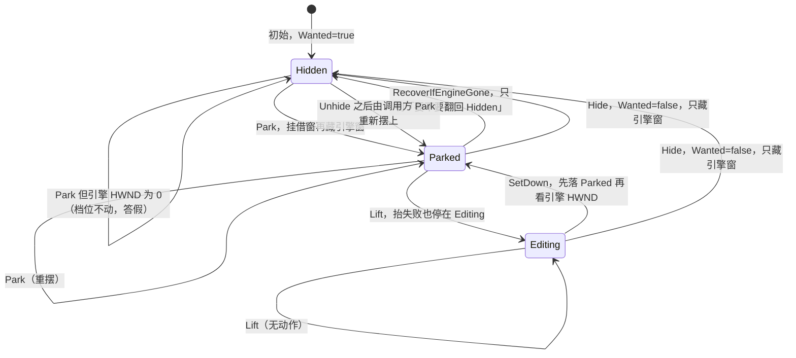

# 桌面日历

桌面日历那一扇窗的宿主与机制。这一份只写形状与机制。
四件「无感」的验收标准在契约 `.scratch/keeper-contract/spec.md`；
取向与被否掉的那几条在 `docs/adr/0007-the-calendar-window-is-under-the-icons.md`。

## 一句话定位

**图标压在日历上面；日历一整块照画，颜色自成一体，不按图标挖洞、不留空段。**
两条都要，不是取舍。2026-10-14 所有者定夺，撤掉 10-12 那条让位定夺。

## 宿主只能是图标层那一扇

日历**挂在 `SHELLDLL_DefView`（图标层）里、排 `SysListView32` 之下**。
这是本机唯一量到的、能被图标压住的排法。

实测：图标层会画挂在它里面的原生子窗（表头那四列都出来了，8560 个采样像素全变），
而画布 `WorkerW` 和 `Progman` 都不画。读数在
`docs/research/desktop-layer-and-window-measurements.md`「WorkerW 那条路」和
「三格都试过」那两节。

## 桌面层查找只有一份快照

产品里找桌面那几扇窗只有一处实施：`DesktopLayer.Read(ensureSplit)` 读一遍桌面、
交出一份快照（Progman、它的全部后代窗、按 z 序的顶层窗、拆桌面发没发 / 答没答真）。
答问题的是三个纯函数，都不再自己读桌面：

| 问句 | 函数 | 筛选条件 | 答 |
| --- | --- | --- | --- |
| 壁纸层那一问 | `WallpaperLayerOf` | 只认类名与父窗；**不筛可见、不筛满屏** | `Layer(Progman, DefView, WorkerW)` |
| 桌面那一扇那一问 | `DesktopTopOf` | Progman 优先，否则顶层 z 序第一扇壁纸层 | 一扇顶层窗的句柄 |
| 日历宿主那一问 | `CalendarHostOf` | **类名 + 可见 + 满屏** | `Host(Progman, DefView, IconList, Measurement)` |

- **`0x052C`（拆桌面）只在宿主那一问发**：不发就没有可挂的画布，那是宿主那一问的事；
  壁纸层那一问不动桌面。
- **两问的筛选条件本来就不同，不许合并**：壁纸层那一问要连不可见的那扇 `DefView`
  也答出来（它就是画布）；宿主那一问收不下不可见或不满屏的 `DefView` ——
  挑中过别的进程留下的空壳。硬取向在 ADR-0003 与 ADR-0007。
- **先拆桌面、再枚举顶层**：拆桌面会拆出新的 `WorkerW`，顶层那一遍必须排在它后面。
- 读快照本身不进自检 —— `--check` 的 `desktop-snapshot` 组拿假快照判三个问句；
  `Read` 由真机 `find` 那一发覆盖。

## 画画的不能是引擎自己那一扇窗

引擎那一扇挂进壳的父子链之后**不画**：三个爹（图标层、画布 `WorkerW`、`Progman`）
各试一次，藏了再放、改尺寸逼交换链重建、强制重绘三种逼法都试过，
**全是 0 像素变化**。

所以日历照旧在场景里用真控件搭、照旧由引擎画到一块离屏视口上，
**再把像素推进那扇原生子窗**。

## 图标层铺满整块屏，所以日历拿不到命中测试

三个点（`(1700,400)`、`(2100,700)`、`(2400,1100)`）命中测试全落到 `SysListView32`。
日历点得动靠的是**全局钩子按坐标判**，不靠窗收鼠标（见 `hit-testing.md`）。

## 壳会拆了重搭，父子关系要重新做一遍

向 `Progman` 发 `0x052C` 才会拆出画布（不发就找不到，之前那一轮「没有可挂的壁纸层」
就是这么来的）。

睡眠唤醒、换分辨率、换 DPI 之后壳会重建这几层，**产品要能自己重新挂上**，
不能只做一次。

## 宿主生命周期

日历窗的「在不在屏上、挂在哪、抬没抬」归档在一族里，和「画什么」分开。
这族住在 `CalendarHost`（`src/CalendarHost.cs`）；`Calendar` 只管布局、格子、备注、
命中、绘制、过午夜和推像素的读回。

### 三档加意图位

档位 `State` 三档：`Hidden`（不在屏上）、`Parked`（摆着：像素挂在图标层底下的
借窗上，引擎窗藏着）、`Editing`（抬着打字）。意图位 `Wanted` 记「托盘要不要它显示」，
初始真，只由 `Hide` / `Unhide` 改 —— 初始是「Hidden 且 Wanted=true」（还没摆过），
不是「被藏了」。

两处次序是搬走之前就成立的，照抄：`Park` 读不到引擎 HWND 时不改档位；
`Lift` 先置 `Editing` 再看抬没抬成。`SetDown` 反过来：先落 `Parked` 再看 HWND。

### 分工

| 收在哪 | 收什么 |
| --- | --- |
| `CalendarHost` | 三档与 `Wanted`；`Park` / `SetDown` / `Lift` / `Hide` / `Unhide` / `Release`；看门狗、到点补推、引擎窗隐藏那一问的计时和次序；「窗没了要不要翻回 Hidden」的判据 |
| `Calendar` | 布局、格子、备注、命中、绘制、过午夜；`PushPixels` 的读回、BGRA、脏旗；桥的清空和计数；编辑框与焦点观测；工作区重排；`Park` 之后的闸门日志和「摆上」那一推 |

到点要推像素时 `CalendarHost` 只发一条 `PushRequest`（为什么推、要不要强推、成没成记不记），
推本身归 `Calendar` —— 那一发要引擎的视口和桥。真正的重摆（`Park("重摆")`）仍由
`Calendar.Tick` 在原位置调，闸门日志和「摆上」那一推才留在原地。

### adapter

module 不直接碰 `DesktopLayer`、Win32、Godot，全部动作收在 `IHostOps` 一份接口后面。

- **真 adapter `DesktopHostOps`**：包 `NativeLayer` 的挂接 / 重挂 / 看门狗 / 抬起 /
  推像素 / 还窗，`DesktopLayer` 的 `HandleOf` / `KeepEngineWindowHidden` / `GrabForTyping`，
  和引擎窗的 `ShowWindow`。引擎句柄缓存在 adapter 里，挂接时重新解析。
  `DesktopLayer.CalendarHost()` 的消费方仍是 `NativeLayer`（卡片 04 定死）。
- **假 adapter `FakeHostOps`**：只给自检，记调用序列、可编排各问的结果 ——
  三档转移、计时、日志逐字这些全在 `--check` 的 `calendar-host` 组判死，不开窗、不碰桌面。

### 计时与每秒的次序

秒数每帧从 `Calendar._Process` 递进 `Advance`；`Calendar.Tick` 每秒调一次 `HostTick`，
固定三段：

1. `Parked` 且看门狗到点：清零、问一次 `Watch`；答不是「宿主没变」就记一行、
   发一条「重挂」强推。
2. `Parked` 且补推到点：清零、累计、重新挂、发一条「到点补推」（成功不记日志），
   累计那一行按分钟出。
3. 每一档都问一次「引擎窗藏没藏住」，答出非空就记。

判据本体（`ShouldRepush`、`ShouldLogRepush`、`HideBeforeMove` 那几发）留在
`NativeLayer`，这一族只递读数、不抄第二份。

### 两处已知缺口（照现状保留，另开票）

1. **托盘藏起来只藏引擎窗。** `Hide` 藏的是引擎窗；借来的那扇还挂在图标层底下，
   屏上那一块可能还在。`Wanted` 与 `CellAt` 照常答「不在屏幕上」。
2. **借来的原生窗死了不重借。** 「窗没了重摆」只判引擎窗；借窗被 explorer 重启带走后，
   看门狗答「没挂着」、补推答假，没有任何一发会自己 `Park`。
   `Attached=false` 而引擎窗活着这一格被自检钉成「不重摆」。

## 落在图标上的那一下，日历不响应

双击图标去打开它时，日历不许被抬起来打字。

## 读 z 序不能拿 `SetWindowPos` 的返回值当读数

那一发答「发出去了没有」，产品自己读一遍兄弟堆次序再记进日志。

## 图标位置那一族读数现在没有消费方

`DesktopIcons.Keep` 那一条「读图标失败不许把上一份好的扔掉」还留着，
它归哪一条由工单定。图标位置改问 UI Automation 的选型、被否掉的那几族、代价都在
`docs/adr/0003-the-window-landing-wallpaper-input.md`
「图标位置：产品侧改问 UI Automation」那一节。

## 三档样式

`calendar.style` 三个取值：

- **`wallpaper`** —— 整月铺在桌面上，每格把自己的备注写在格子**里面**。声明表的默认值是它。
- **`outline`** —— 同一套格子，**一颗底色都不填**，字直接压在壁纸上。
- **`widget`** —— 角落那块面板。

`outline` 那一档的名字是 **bare rules and text**：**bare rules** 是那几根细线格，
**text** 是字直接压在壁纸上。细线格今天实物读不到线 —— 那一发欠在
`.scratch/keeper-debt/issues/09-outline-rules-not-drawn.md`，补它才要写 `_draw`。

## 布局算术

占桌面多少是两个份额（一条边一个），锚在哪个角、往里推多远也都是份额 ——
**全部相对工作区**，不是屏幕、不是像素。

角落那块面板由一个给的数决定，格子、抬头、文字都从它派生；
字号那一份对着一根跟随系统缩放的地板。

链是**「工作区 × 份额 → 面板 → 格子 → 文字」**。唯一还在像素的是地板本身，
和「一行的字不许宽过它待的那个框」这条可读性限制 —— **装不下那一行就不画**。
